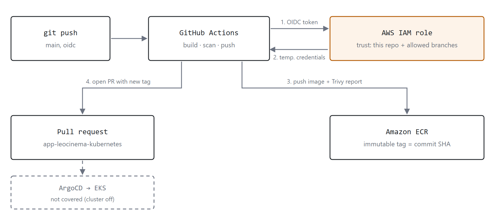

# tf-oidc

Terraform for the AWS side of the LeoCinema CI pipelines: **GitHub Actions authenticates to AWS with OIDC**, so there are no long-lived access keys in GitHub secrets.



The workflow that uses this role lives in [app-leocinema-backend](https://github.com/leonardobgsilva/app-leocinema-backend) (branch `oidc`). It builds the image, pushes it to ECR with an immutable SHA tag, runs Trivy and opens a pull request in the GitOps repository.

## What it creates

| Resource | Purpose |
|---|---|
| `aws_iam_openid_connect_provider` | Trust relationship with `token.actions.githubusercontent.com` |
| `aws_iam_role` `leocinema-gha-ecr-push` | Role that GitHub Actions assumes. Only the listed repositories and refs can assume it |
| `aws_iam_role_policy` | `ecr:GetAuthorizationToken` plus push access on the two LeoCinema repositories only. No `AdministratorAccess` |
| `aws_ecr_repository` x2 | `leocinema-backend` and `leocinema-frontend`: **immutable tags**, scan on push, AES256 |
| `aws_ecr_lifecycle_policy` x2 | Keeps the last 10 images per repository |

Nothing here bills by the hour. The only recurring cost is ECR storage for a few small images.

## How the trust is restricted

The role can be assumed only when the OIDC token has:

- `aud` = `sts.amazonaws.com`
- `sub` = `repo:<owner>/<repo>:ref:<ref>` for each repository in `github_repositories` and each ref in `allowed_refs`

By default that means the `main` and `oidc` branches of `app-leocinema-backend` and `app-leocinema-frontend`. Pull requests from forks do not match.

## Usage

```bash
terraform init
terraform plan
terraform apply
```

Then use the `role_arn` output in the workflow:

```yaml
permissions:
  id-token: write
  contents: read

steps:
  - uses: aws-actions/configure-aws-credentials@v4
    with:
      role-to-assume: <role_arn output>
      aws-region: us-east-1
  - uses: aws-actions/amazon-ecr-login@v2
```

## Known limits

- The deploy of the ECR image on EKS was **not tested** (the cluster is off to avoid cost). The pipeline is validated up to the GitOps pull request.
- The GitOps pull request uses a fine-grained token (limited to one repository), which is still a long-lived secret. A GitHub App would be the next step.

## Why this is a separate stack

The EKS stack of the project is destroyed after each test to avoid cost. The OIDC provider, the role and the ECR repositories have to survive that, so they live here.

## Variables

| Name | Default | Description |
|---|---|---|
| `github_owner` | `leonardobgsilva` | GitHub user that owns the repositories |
| `github_repositories` | backend, frontend | Repositories allowed to assume the role |
| `allowed_refs` | `main`, `oidc` | Git refs allowed to assume the role |
| `ecr_repository_names` | `leocinema-backend`, `leocinema-frontend` | ECR repositories to create |
| `max_image_count` | `10` | Images kept per repository |

State is local and ignored by Git. For a team setup, move it to an S3 backend with locking.
